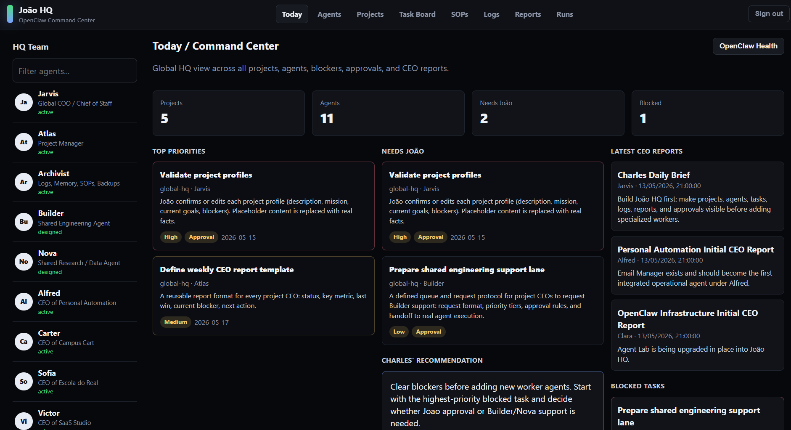
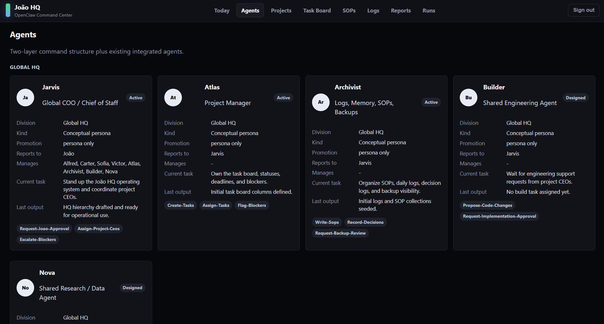
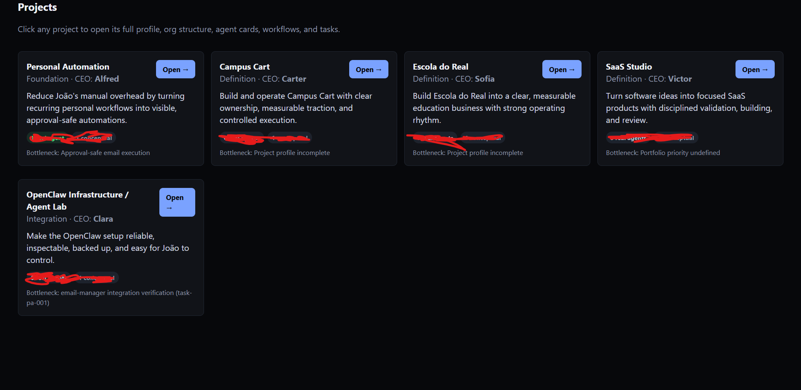
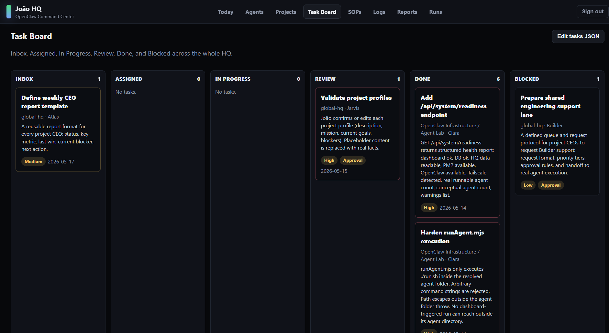
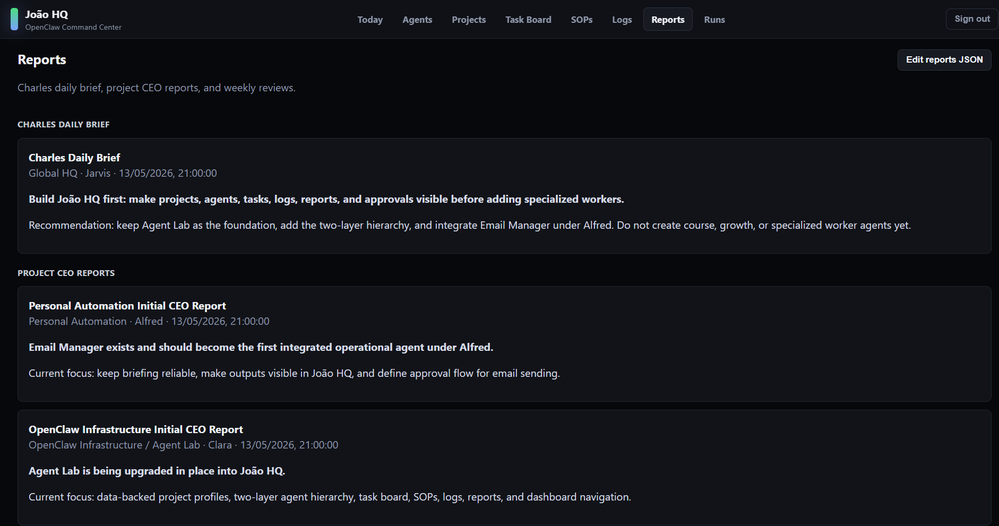

# OpenClaw Startup HQ

**A local command center and "software factory" for running AI coding agents like a small, auditable engineering team, with the founder approving every merge.**

You give it an outcome. It turns that into bounded GitHub work, assigns one agent to build it on an isolated branch, has a different agent review it, collects QA and security evidence, and hands back a merge-ready recommendation. Nothing merges, deploys, or spends money without a human decision.



## Who it's for

A solo founder or very small team running one or more early products who wants the leverage of many agents without losing control or an audit trail. I built it for myself first: I use it to run the agent-driven work on my own projects from an always-on mini PC. It is a personal operations tool, not a product I sell.

## Status (honest version)

- Early and working, in active use by one person (me). The core loop runs: a task goes through the stages, gets independent review, and waits for my merge.
- Final merge is human-only by design. The factory does not deploy to production or spend money on its own.
- The public repo is a clean slice of a private setup. OpenClaw runtime state, tokens, and logs are not included.
- Live console (sign-in required, so you will only see a login page): https://openclaw-agents-headquarter.vercel.app. It is a read-only viewer of a snapshot that the factory machine publishes outbound; it never reaches back into the machine.
- Not production-hardened. Expect rough edges.

## How it works

```text
founder outcome
   -> Chief of Staff turns it into a GitHub issue (outcome, acceptance criteria, risk)
   -> pipeline: product -> architect -> builder -> reviewer -> QA -> security -> release
        one task = one branch (factory/<task-id>) = one writable worktree
        a model can never be the sole reviewer of its own work
   -> evidence-backed completion + independent security gate
   -> PR to main, merge-ready recommendation
   -> founder merges (high-risk work needs a signed founder approval before build)
```

What is in the repo:

- **Workflow engine** (`factory/lib/`): the 7-stage task state machine, OpenClaw dispatch protocol, handoffs, leases and liveness checks, evidence and independence gates, failure classification, model-usage and cost tracking, audit events.
- **Project intelligence layer** (`context/`, `factory/lib/intel/`): each project carries durable context (vision, mission, decisions, risks) that is injected into every agent handoff, plus a machine-readable decision protocol for deciding what must go to the founder.
- **Founder control plane** (`dashboard/backend/`, `control-plane/`): an Express dashboard with login, CSRF and CSP protections for tasks, blockers, decisions, projects, reports and cost; and a small static viewer deployed on Vercel from a published snapshot.
- **Worker agents** (`agents/`, `scripts/`): the original HQ layer. Each agent is a folder with a config, prompt and a single `./run.sh` entrypoint, which is the only thing the dashboard will execute.
- **Docs** (`docs/software-factory/`): operating rules, git workflow, founder authority, model policy, decisions log, incident write-ups, and cost measurements.

A cost measurement in `docs/` found the factory's own cost panel undercounting real agent spend by about three orders of magnitude, and the fix and write-up are in the repo. Cost accuracy is treated as a first-class problem because agents spend real money.

## Quick start

Requires Node.js and a Unix-like shell. OpenClaw itself is separate and optional for trying the dashboard.

```bash
git clone https://github.com/7thcapitalist/Openclaw-Agents-Headquarter.git
cd Openclaw-Agents-Headquarter
cp .env.example .env          # set DASHBOARD_PASSWORD and DASHBOARD_SESSION_SECRET
npm run setup                 # installs dashboard/backend and control-plane
npm run register:example
npm run dev
```

Open `http://127.0.0.1:3000` and log in with the password from `.env`.

Run the factory tests with `npm run test:factory`. It needs `dashboard/backend` installed and refuses to start without it, because the CSRF, CSP, session and stored-XSS tests would otherwise skip themselves and the run would look green with 14 security tests never executed. `control-plane`'s dependencies are only needed to serve it, not to test it.

Other entry points are listed in `package.json` (`factory:doctor`, `factory:report`, `hq:status`, `factory:smoke`, and more).

## Create a worker

```bash
./scripts/create-agent.sh personal-automation email-manager
```

Edit `agent.config.json`, `prompt.md` and `run.sh` in `agents/personal-automation/email-manager/`, then register it:

```bash
./scripts/register-agent.sh personal-automation email-manager
```

## Dashboard layout (original HQ layer)

```text
openclaw-startup-hq/
├── dashboard/backend/       # Express dashboard and API
│   ├── lib/                 # agent scanning, readiness, runs, HQ state
│   └── public/              # browser UI
├── scripts/                 # create/register/start/stop agent helpers
├── agents/                  # runnable worker-agent folders
└── docs/screenshots/        # dashboard screenshots for GitHub
```

The main layers are:

1. **OpenClaw runtime**: the local automation runtime and provider gateway.
2. **Startup HQ dashboard**: the browser interface, SQLite run history, and JSON command-center state.
3. **Worker agents**: folders with clear prompts, configs, logs, outputs, and a single safe entrypoint.

## Stack

This is the stack I am using around the HQ:

- **Mini PC** as the always-on local machine.
- **OpenClaw** as the local agent/runtime gateway.
- **Node.js** for the dashboard backend and worker scripts.
- **Express** for the local dashboard API.
- **SQLite** for registered agents, run history, sessions, and events.
- **JSON files** for HQ state: projects, agents, tasks, SOPs, logs, and reports.
- **PM2** to keep the dashboard process running.
- **systemd user services** for long-running local automation services.
- **Tailscale/private networking** for private access to the dashboard when I am away from the machine.
- **Shell entrypoints** through `run.sh` so every worker has one clear execution boundary.

## Agent Lifecycle

| Status | Meaning |
| --- | --- |
| `idea` | A rough concept only. |
| `designed` | A persona or role exists in HQ JSON. |
| `scaffolded` | A folder exists, but it is not fully runnable yet. |
| `runnable` | Required files exist and the agent can run manually. |
| `scheduled` | Runnable and connected to timer/cron behavior. |
| `active` | Operational and expected to work now. |
| `disabled` | Intentionally inactive. |
| `failed` | Last known operational state is bad. |

The dashboard computes whether an HQ entry is a `conceptual-persona` or an `executable-agent`.

## Runnable Agent Shape

Every real worker agent uses this shape:

```text
agents/<project>/<agent-id>/
├── agent.config.json
├── prompt.md
├── run.sh
├── logs/
└── outputs/
```

The dashboard only runs `./run.sh` inside the resolved agent folder. That keeps the command surface intentionally small.

## OpenClaw Integration

This repo does not include private OpenClaw state. In my local setup, OpenClaw runs separately and this HQ calls into it through agent `run.sh` wrappers and health checks.

For example, a worker can wrap an OpenClaw command, a cron job, a Node script, or any local automation as long as the dashboard entrypoint remains `./run.sh`.

## Screenshots

These are real screenshots from my current dashboard. Some private details are intentionally redacted.

### Today / Command Center


### Agents



### Projects



### Task Board



### Reports



## What Is Not Included

This repo intentionally excludes:

- private `~/.openclaw` runtime data
- tokens and auth profiles
- Telegram, Gmail, or provider credentials
- local SQLite runtime databases
- personal logs and generated outputs

## Roadmap

From `context/ROADMAP.md`:

1. Decision queue (open, answer, accept, reject, expire) with an appended decisions log.
2. Five deterministic sensors on a schedule that raise questions before a task blocks.
3. GitHub label/webhook to dispatcher invocation, and durable PR creation and review-comment sync.
4. Per-project digest and a daily/weekly founder digest.
5. Later, and only with a new explicit founder decision: a considered path to auto-merge for low-risk work.

## Contributing and workflow

`main` is the only permanent branch. Every change, by me or by an agent, lands through a PR from a short-lived branch. See `docs/software-factory/GIT_WORKFLOW.md`.

## Team / contact

Built and run by João Vitor Carvalho ([@7thcapitalist](https://github.com/7thcapitalist)). The same agent-first approach is how we work on [AI4accounting](https://github.com/7thcapitalist/AI4accounting).
